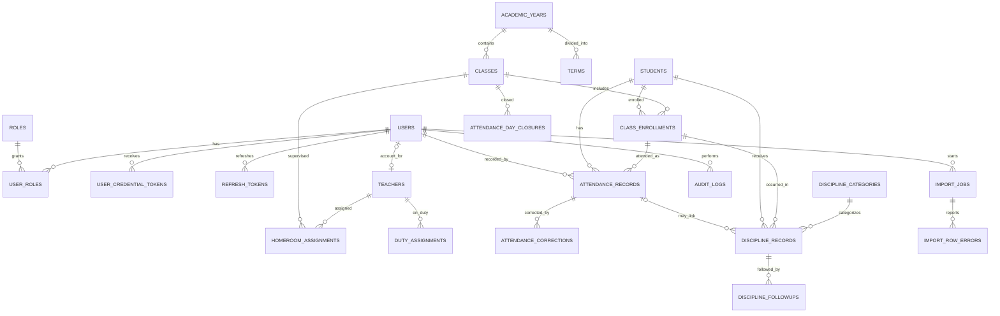

# DATABASE_DESIGN.md

# Database Design: Aplikasi Absensi dan Kedisiplinan Sekolah

> **Versi:** 2.2 (keputusan implementasi 21 Okt 2026; revisi dari 2.1)
> **Status:** Disetujui untuk implementasi MVP. DDL tetap ilustratif; migration final dibuat bertahap.
> **Database:** PostgreSQL 14+ | **Data access:** `pgx` + `sqlc` | **Migration:** `golang-migrate`
> **Acuan utama:** `PRD.md` v1.0 (School Attendance & Discipline Management System).
> **Sudah disinkronkan dengan:** `TECH_STACK.md` (JWT access + refresh token, storage file import, dan Redis/RabbitMQ opsional).
>
> Keputusan 21 Okt 2026: R1–R12 disetujui; O1–O10 diterapkan termasuk `principal` (O7);
> import bersifat **all-or-nothing**; koreksi absensi memakai `attendance_corrections`
> sebagai audit trail resmi; refresh token disimpan di `refresh_tokens`.

## 0. Cara membaca dokumen ini

Setiap keputusan di dokumen ini punya salah satu label:

| Label | Arti |
|---|---|
| **[PRD]** | Sudah ditetapkan PRD. Tidak perlu didiskusikan ulang. Rujukan FR atau bagian PRD disebutkan. |
| **[REK]** | Rekomendasi desain yang tidak tertulis di PRD. Perlu disetujui sebelum migration dibuat. |
| **[DEFAULT]** | Butuh keputusan sekolah, tetapi sudah diberi nilai bawaan berdasarkan praktik umum sekolah di Indonesia dan aplikasi sejenis, agar pengembangan tidak menunggu klien. Jika klien berbeda, ubah sesuai kolom "Jika klien berbeda" di bagian 11.3. |
| **[TERBUKA]** | Butuh keputusan dan belum ada nilai bawaan. Constraint terkait **belum** boleh difinalisasi. (Pada v2.1 tidak ada item berstatus ini.) |

Seluruh DDL di dokumen ini bersifat **ilustratif** untuk review, bukan file migration.

> **Catatan kejujuran untuk item [DEFAULT]:** dasarnya adalah praktik umum (semester ganjil/genap, rekap sakit/izin/tanpa keterangan di rapor, satu wali kelas per kelas, piket bergilir per hari). Dasar ini **belum diverifikasi terhadap regulasi tertentu** (peraturan kementerian atau dinas pendidikan daerah). Angka seperti jam penutupan dan masa simpan adalah nilai operasional awal, bukan ketentuan hukum.

---

## 1. Tujuan dan ruang lingkup

Mendukung aplikasi web untuk **satu sekolah** pada tahap MVP **[PRD §1.4]**:

- akun, RBAC, dan hak akses (3 peran utama + `principal` hanya baca sesuai O7);
- data siswa, guru, kelas, tahun ajaran, penugasan wali kelas dan guru piket;
- absensi harian siswa oleh guru atau guru piket;
- kedisiplinan (kategori, pelanggaran, poin, tindak lanjut);
- import dan export Excel;
- laporan dan dashboard;
- audit perubahan data penting.

### Di luar MVP (dihapus dari desain v1)

Hal-hal berikut **tidak ada di PRD** atau dikecualikan secara eksplisit **[PRD §7]**, sehingga tidak dimodelkan:

- absensi guru dengan Geofencing, `school_locations`, dan GPS tracking (PRD §7 butir 10 dan 16);
- absensi mandiri siswa, peran `student`, akun siswa, dan portal orang tua (PRD hanya mengenal pencatatan oleh guru dan petugas; portal orang tua di §7 butir 7);
- absensi per mata pelajaran / `attendance_sessions` (PRD §7 butir 15);
- multi-tenant aktif (`tenant_id`) (PRD §7 butir 14).

Jika salah satu fitur di atas ingin dimasukkan ke MVP, **ubah PRD terlebih dahulu**, baru desain database. Catatan untuk masa depan ada di bagian 12.

---

## 2. Prinsip desain

1. PostgreSQL adalah sumber kebenaran data. Redis (jika dipakai) bukan sumber kebenaran catatan absensi.
2. UUID sebagai primary key entitas utama (`gen_random_uuid()`, bawaan PostgreSQL 13+).
3. Timestamp bertipe `timestamptz`, disimpan sebagai UTC. Tanggal absensi (`date`) dihitung backend dari zona waktu sekolah.
4. **Integritas ditegakkan di database** (FK, unique, check, exclusion, transaksi). Validasi di aplikasi adalah lapisan tambahan, bukan satu-satunya pengaman. **[PRD FR-A03, NFR-01]**
5. Data historis tidak dihapus. Semua FK memakai `ON DELETE RESTRICT` (default). **Tidak ada `ON DELETE CASCADE` pada data historis.** Pengarsipan dilakukan lewat kolom `status`. **[PRD §5.2]**
6. Tidak ada tabel generik atau abstraksi yang belum dibutuhkan. Koreksi absensi punya tabel khusus, bukan hanya `audit_logs`.
7. Password hanya disimpan sebagai hash. Tidak ada password default bersama. **[PRD FR-G02]**
8. Perubahan data penting dan catatan audit-nya ditulis dalam **transaksi yang sama**.
9. Jangan finalisasi constraint yang bergantung pada keputusan berstatus **[TERBUKA]**.

---

## 3. ERD konseptual



Tabel berdiri sendiri (tanpa relasi penting): `school_settings`, `school_schedules`, `school_holidays`.

---

## 4. Akun dan RBAC

### 4.1 `users`

```sql
CREATE TABLE users (
  id            uuid PRIMARY KEY DEFAULT gen_random_uuid(),
  username      varchar(100) NOT NULL,
  email         varchar(255),
  password_hash text,
  full_name     varchar(150) NOT NULL,
  status        varchar(20)  NOT NULL DEFAULT 'pending'
                CHECK (status IN ('pending','active','inactive','locked','system')),
  last_login_at timestamptz,
  created_at    timestamptz  NOT NULL DEFAULT now(),
  updated_at    timestamptz  NOT NULL DEFAULT now(),
  CHECK (username = btrim(username) AND username <> ''),
  CHECK (status IN ('pending','system') OR password_hash IS NOT NULL)
);
CREATE UNIQUE INDEX users_username_uq ON users (lower(username));
CREATE UNIQUE INDEX users_email_uq    ON users (lower(email)) WHERE email IS NOT NULL;
```

- Login memakai username atau email **[PRD FR-A01]**. Keduanya dinormalisasi dengan `lower()`.
- Status `pending` = akun dibuat admin, belum diaktifkan pemiliknya, dan belum punya password. Ini mengganti kebutuhan "password awal yang sama untuk semua" yang dilarang **[PRD FR-G02]**. **[REK]**
- Akun `inactive` dan `locked` tidak boleh login **[PRD §8]**.
- Status `system` dipakai satu akun internal (`username = 'system'`, dibuat di migration) untuk baris yang dibuat sistem, yaitu penutupan absensi otomatis. Akun ini tidak punya password dan tidak bisa login. **[DEFAULT O3]**
- `password_hash` tidak pernah dikembalikan lewat API.
- Autentikasi: JWT access token berumur pendek (15 menit) di header
  `Authorization: Bearer`; refresh token opaque 7 hari, dirotasi setiap
  refresh, disimpan sebagai hash SHA-256 di `refresh_tokens`, dan dikirim
  lewat cookie `HttpOnly`/`Secure`/`SameSite=Strict` (path
  `/api/v1/auth`). Access token hanya berisi `sub` dan klaim standar;
  status akun dan peran dibaca dari database pada setiap request agar
  penonaktifan akun langsung berlaku.
- Deteksi pemakaian ulang refresh token yang sudah dirotasi: cabut semua
  refresh token aktif milik pengguna tersebut.
- Password di-hash dengan bcrypt (cost 12) atau Argon2id. Pilih satu saat
  implementasi; jangan menyimpan password asli.

### 4.2 `user_credential_tokens` **[REK]**

Mekanisme aman untuk aktivasi akun dan reset akses **[PRD FR-A02, FR-G02]**.

```sql
CREATE TABLE user_credential_tokens (
  id         uuid PRIMARY KEY DEFAULT gen_random_uuid(),
  user_id    uuid NOT NULL REFERENCES users(id),
  purpose    varchar(20) NOT NULL CHECK (purpose IN ('invite','reset')),
  token_hash char(64) NOT NULL UNIQUE,      -- hash dari token, bukan token asli
  expires_at timestamptz NOT NULL,
  used_at    timestamptz,
  created_by uuid REFERENCES users(id),
  created_at timestamptz NOT NULL DEFAULT now()
);
```

### 4.3 `refresh_tokens`

Menyimpan refresh token yang aktif. Token asli hanya dikirim ke client;
database hanya menyimpan hash SHA-256.

```sql
CREATE TABLE refresh_tokens (
  id          uuid PRIMARY KEY DEFAULT gen_random_uuid(),
  user_id     uuid NOT NULL REFERENCES users(id),
  token_hash  char(64) NOT NULL UNIQUE,
  expires_at  timestamptz NOT NULL,
  revoked_at  timestamptz,
  replaced_by uuid REFERENCES refresh_tokens(id) ON DELETE SET NULL,
  created_at  timestamptz NOT NULL DEFAULT now()
);
CREATE INDEX refresh_tokens_user_idx ON refresh_tokens (user_id, expires_at);
```

- Refresh token opaque 32 byte acak (base64url), bukan JWT.
- Rotasi: dalam satu transaksi, token lama diisi `revoked_at` dan
  `replaced_by`, lalu token baru dibuat.
- Jika token yang sudah `revoked_at` dipakai lagi, cabut seluruh refresh
  token aktif pengguna tersebut (indikasi pencurian token).
- Logout mencabut refresh token yang sedang dipakai.
- Token kedaluwarsa/dicabut dihapus oleh job retensi setelah 30 hari.
- Cookie refresh: `HttpOnly`, `Secure` (production), `SameSite=Strict`,
  path `/api/v1/auth`. Endpoint refresh/logout juga memeriksa `Origin`
  yang diizinkan.

### 4.4 `roles` dan `user_roles` **[PRD §2]**

```sql
CREATE TABLE roles (
  code        varchar(50) PRIMARY KEY,   -- 'admin', 'teacher', 'duty_teacher', 'principal'
  name        varchar(100) NOT NULL,
  description text
);

CREATE TABLE user_roles (
  user_id     uuid NOT NULL REFERENCES users(id),
  role_code   varchar(50) NOT NULL REFERENCES roles(code),
  assigned_at timestamptz NOT NULL DEFAULT now(),
  assigned_by uuid REFERENCES users(id),
  PRIMARY KEY (user_id, role_code)
);
```

Peran awal (seed): `admin` (Administrator Sekolah), `teacher` (Guru / Wali Kelas), `duty_teacher` (Guru Piket), dan `principal` (Kepala Sekolah, hanya baca; **[DEFAULT O7] disetujui**). Satu pengguna boleh memiliki lebih dari satu peran **[PRD §2.3]**.

**[REK] Tidak ada role `homeroom_teacher`.** Status wali kelas diturunkan dari `homeroom_assignments` yang aktif, sehingga tidak ada dua sumber kebenaran yang bisa tidak sinkron (role bilang wali kelas, penugasan bilang bukan). Peran `student` dihapus karena tidak ada di PRD. Peran `principal` ditambahkan sebagai **[DEFAULT O7]**: PRD menyebut laporan untuk kepala sekolah (§1.1) tetapi tidak menyebut perannya.

### 4.5 Dasar otorisasi data

Role menentukan *jenis* kemampuan. *Cakupan data* ditentukan penugasan:

| Pengguna | Cakupan data absensi dan kedisiplinan |
|---|---|
| `admin` | Seluruh sekolah |
| `teacher` | Kelas dengan `homeroom_assignments` aktif pada tanggal terkait |
| `duty_teacher` | Seluruh kelas, **hanya pada hari ia punya `duty_assignments` aktif** (peran saja tidak cukup; gagal aman jika salah satunya tidak ada) **[DEFAULT O5]** |
| `principal` | Seluruh sekolah, hanya baca (dashboard dan laporan) |

Pemeriksaan dilakukan di backend untuk setiap operasi **[PRD FR-A03]**. Row-Level Security PostgreSQL tidak dipakai di MVP agar kompatibel dengan `sqlc` dan tetap sederhana.

---

## 5. Data master

### 5.1 `students` **[PRD FR-C01]**

```sql
CREATE TABLE students (
  id                      uuid PRIMARY KEY DEFAULT gen_random_uuid(),
  student_number          varchar(50)  NOT NULL,          -- NIS, teks (bukan angka)
  national_student_number varchar(20),                    -- NISN, opsional
  full_name               varchar(150) NOT NULL,
  gender                  varchar(1)   CHECK (gender IN ('L','P')),
  birth_date              date,
  admission_year          smallint     NOT NULL CHECK (admission_year BETWEEN 1990 AND 2100),
  status                  varchar(20)  NOT NULL DEFAULT 'active'
                          CHECK (status IN ('active','graduated','transferred','inactive')),
  guardian_name           varchar(150),
  guardian_phone          varchar(30),
  created_at              timestamptz NOT NULL DEFAULT now(),
  updated_at              timestamptz NOT NULL DEFAULT now(),
  CONSTRAINT students_nis_uq  UNIQUE (student_number),
  CONSTRAINT students_nisn_uq UNIQUE (national_student_number),
  CHECK (student_number = btrim(student_number) AND student_number <> '')
);
```

- NIS `NOT NULL UNIQUE`: PRD menjadikannya identitas utama untuk deteksi duplikat dan upsert import **[PRD FR-G01, FR-G08]**. `UNIQUE` pada kolom nullable mengizinkan banyak `NULL`, sehingga duplikat tidak terdeteksi.
- **NIS harus diperlakukan sebagai teks di seluruh jalur import.** Excel dapat mengubah "00123" menjadi 123. Parser harus membaca sel sebagai string dan menormalisasi (trim) sebelum dibandingkan.
- Kolom `user_id` dan akun siswa dihapus (tidak ada di PRD).
- "Arsip" siswa = `status <> 'active'`. Riwayat absensi dan kedisiplinan tetap utuh **[PRD FR-C03]**.
- Tidak mengumpulkan data sensitif yang tidak diperlukan (alamat, NIK, dsb.) **[PRD FR-C01, NFR-05]**.
- Pencarian nama: pada skala satu sekolah, `ILIKE` cukup. Tambahkan `pg_trgm` hanya jika `EXPLAIN` menunjukkan perlu.

### 5.2 `teachers` **[PRD FR-D01]**

```sql
CREATE TABLE teachers (
  id              uuid PRIMARY KEY DEFAULT gen_random_uuid(),
  user_id         uuid UNIQUE REFERENCES users(id),     -- NULL = belum punya akun
  employee_number varchar(50) UNIQUE CHECK (employee_number <> ''),
  full_name       varchar(150) NOT NULL,
  email           varchar(255),
  phone           varchar(30),
  status          varchar(20) NOT NULL DEFAULT 'active' CHECK (status IN ('active','inactive')),
  created_at      timestamptz NOT NULL DEFAULT now(),
  updated_at      timestamptz NOT NULL DEFAULT now()
);
```

- **`user_id` nullable (perbaikan dari v1).** Import guru tidak boleh otomatis membuat akun **[PRD FR-G02]**, sehingga guru harus bisa ada tanpa akun.
- `teachers.email` adalah kontak kepegawaian dan data hasil import. `users.email` adalah identitas login. Saat akun dibuat, aplikasi menyalin email sekali. **Tidak ada sinkronisasi otomatis sesudahnya**; perubahan salah satunya adalah keputusan sadar.
- NIP unik jika diisi. String kosong ditolak oleh `CHECK`, sehingga import harus mengubah sel kosong menjadi `NULL`.

### 5.3 `academic_years` **[PRD FR-E04]**

```sql
CREATE EXTENSION IF NOT EXISTS btree_gist;

CREATE TABLE academic_years (
  id         uuid PRIMARY KEY DEFAULT gen_random_uuid(),
  name       varchar(30) NOT NULL UNIQUE,            -- '2026/2027'
  start_date date NOT NULL,
  end_date   date NOT NULL,
  is_active  boolean NOT NULL DEFAULT false,
  created_at timestamptz NOT NULL DEFAULT now(),
  updated_at timestamptz NOT NULL DEFAULT now(),
  CHECK (end_date > start_date),
  EXCLUDE USING gist (daterange(start_date, end_date, '[]') WITH &&)
);
CREATE UNIQUE INDEX academic_years_one_active ON academic_years (is_active) WHERE is_active;
```

Tahun ajaran tidak boleh tumpang tindih dan hanya satu yang aktif.

#### `terms` (semester) **[DEFAULT O1]**

PRD menyebut admin mengatur "tahun ajaran dan semester" (§2.1) tetapi data modelnya tidak memuat semester. Bawaan: dua semester per tahun ajaran (1 = Ganjil, 2 = Genap).

```sql
CREATE TABLE terms (
  id               uuid PRIMARY KEY DEFAULT gen_random_uuid(),
  academic_year_id uuid NOT NULL REFERENCES academic_years(id),
  term_number      smallint NOT NULL CHECK (term_number BETWEEN 1 AND 4),
  name             varchar(30) NOT NULL,              -- 'Ganjil', 'Genap'
  start_date       date NOT NULL,
  end_date         date NOT NULL,
  CHECK (end_date > start_date),
  UNIQUE (academic_year_id, term_number),
  EXCLUDE USING gist (academic_year_id WITH =, daterange(start_date, end_date, '[]') WITH &&)
);
```

- Semester **tidak direferensikan** oleh tabel absensi atau kedisiplinan. Ia hanya filter periode laporan (rentang tanggalnya), sehingga menghapus atau mengabaikan tabel ini tidak memengaruhi tabel lain.
- Rentang semester harus berada di dalam rentang tahun ajaran induknya: tegakkan dengan trigger (aturan #15, bagian 10).
- `term_number` sampai 4 menampung sekolah yang memakai tri- atau caturwulan.

### 5.4 `classes` **[REK: kelas per tahun ajaran]**

```sql
CREATE TABLE classes (
  id               uuid PRIMARY KEY DEFAULT gen_random_uuid(),
  academic_year_id uuid NOT NULL REFERENCES academic_years(id),
  name             varchar(100) NOT NULL,
  grade_level      smallint NOT NULL CHECK (grade_level BETWEEN 1 AND 13),
  major            varchar(100),                      -- jurusan/peminatan (SMA/SMK); NULL jika tidak dipakai
  status           varchar(20) NOT NULL DEFAULT 'active' CHECK (status IN ('active','archived')),
  created_at       timestamptz NOT NULL DEFAULT now(),
  updated_at       timestamptz NOT NULL DEFAULT now(),
  UNIQUE (academic_year_id, name)
);
```

**Alasan perubahan dari v1:** v1 menyimpan `grade_level` pada identitas kelas yang dipakai lintas tahun. Padahal "X-1" tahun ini dan "XI-1" tahun depan adalah rombongan belajar yang berbeda, sehingga `grade_level` menjadi salah untuk data lama. PRD meminta data kelas memiliki konteks tahun ajaran **[PRD FR-C04]**. Dengan `classes` per tahun ajaran:

- `academic_year_id` tidak perlu diulang di `class_enrollments`, `homeroom_assignments`, maupun absensi (diturunkan lewat kelas), sehingga tidak ada kemungkinan data bertentangan.
- Kolom `major` (jurusan) nullable, dipertahankan sebagai **[DEFAULT O9]**: lazim pada SMA/SMK, dan `grade_level` 1 sampai 13 menampung SD sampai SMA/SMK. Abaikan jika tidak dipakai.

### 5.5 `class_enrollments` **[PRD §5.1, FR-C03]**

```sql
CREATE TABLE class_enrollments (
  id         uuid PRIMARY KEY DEFAULT gen_random_uuid(),
  student_id uuid NOT NULL REFERENCES students(id),
  class_id   uuid NOT NULL REFERENCES classes(id),
  start_date date NOT NULL,
  end_date   date,                                   -- NULL = masih berlaku
  created_by uuid REFERENCES users(id),
  created_at timestamptz NOT NULL DEFAULT now(),
  CHECK (end_date IS NULL OR end_date >= start_date),
  CONSTRAINT enrollments_id_student_uq UNIQUE (id, student_id),   -- target composite FK
  CONSTRAINT enrollments_no_overlap
    EXCLUDE USING gist (student_id WITH =, daterange(start_date, end_date, '[]') WITH &&)
);
CREATE INDEX enrollments_class_idx ON class_enrollments (class_id, start_date);
```

- Skema memakai `start_date`/`end_date`, artinya perpindahan kelas di tengah tahun **didukung**. Karena itu `UNIQUE (student_id, academic_year_id)` saja tidak cukup. Yang menjamin satu siswa tidak berada di dua kelas pada waktu yang sama adalah **exclusion constraint** di atas (nilai `end_date` bersifat inklusif; pindah kelas pada tanggal D berarti baris lama `end_date = D-1`, baris baru `start_date = D`).
- Satu siswa tidak punya dua penempatan yang bertumpuk **lintas tahun** juga, karena constraint berlaku pada seluruh baris siswa tersebut.
- **Tidak bisa ditegakkan oleh constraint deklaratif:** rentang `start_date`..`end_date` harus berada di dalam rentang tahun ajaran milik `class_id`. Tegakkan dengan trigger `BEFORE INSERT OR UPDATE` dan uji dengan integration test.
- Daftar siswa suatu kelas pada tanggal D: enrollment dengan `start_date <= D AND (end_date IS NULL OR end_date >= D)`.

### 5.6 `homeroom_assignments` dan `duty_assignments` **[PRD FR-D02]**

```sql
CREATE TABLE homeroom_assignments (
  id         uuid PRIMARY KEY DEFAULT gen_random_uuid(),
  teacher_id uuid NOT NULL REFERENCES teachers(id),
  class_id   uuid NOT NULL REFERENCES classes(id),
  start_date date NOT NULL,
  end_date   date,
  created_by uuid REFERENCES users(id),
  created_at timestamptz NOT NULL DEFAULT now(),
  CHECK (end_date IS NULL OR end_date >= start_date),
  -- [REK] satu kelas hanya punya satu wali kelas pada satu waktu
  CONSTRAINT homeroom_one_teacher_per_class
    EXCLUDE USING gist (class_id WITH =, daterange(start_date, end_date, '[]') WITH &&),
  -- [DEFAULT O5] satu guru menjadi wali satu kelas pada satu waktu
  CONSTRAINT homeroom_one_class_per_teacher
    EXCLUDE USING gist (teacher_id WITH =, daterange(start_date, end_date, '[]') WITH &&)
);

CREATE TABLE duty_assignments (                      -- penugasan guru piket per hari dalam pekan
  id         uuid PRIMARY KEY DEFAULT gen_random_uuid(),
  teacher_id uuid NOT NULL REFERENCES teachers(id),
  weekday    smallint NOT NULL CHECK (weekday BETWEEN 1 AND 7),   -- ISO: 1=Senin .. 7=Minggu
  start_date date NOT NULL,
  end_date   date,
  created_by uuid REFERENCES users(id),
  created_at timestamptz NOT NULL DEFAULT now(),
  CHECK (end_date IS NULL OR end_date >= start_date),
  EXCLUDE USING gist (teacher_id WITH =, weekday WITH =, daterange(start_date, end_date, '[]') WITH &&)
);
```

- `duty_assignments` memenuhi "menetapkan guru piket" dan riwayatnya **[PRD FR-D02]**. **[DEFAULT O5]** Piket bersifat **bergilir per hari dalam pekan**: "Pak A piket setiap Senin selama semester ini" adalah satu baris. Pengganti sekali pakai adalah baris dengan `start_date = end_date` (weekday harus cocok dengan tanggal; divalidasi aplikasi). Beberapa guru boleh piket pada hari yang sama.
- **Akses piket efektif** = punya role `duty_teacher` **dan** ada `duty_assignments` dengan `weekday` = hari ini (zona waktu sekolah) dan hari ini berada di rentang tanggalnya. PRD §2.3 menyatakan hak akses piket "dapat dibatasi"; ini cara pembatasannya.
- **Satu guru satu kelas sebagai wali** dijamin `homeroom_one_class_per_teacher`. Jika klien mengizinkan satu guru memegang beberapa kelas, cukup `DROP CONSTRAINT` tersebut.

---

## 6. Konfigurasi sekolah **[PRD FR-E04]**

PRD mewajibkan administrator dapat mengatur jam masuk, batas keterlambatan, hari operasional, dan kalender libur. Ini bukan opsional, karena persentase kehadiran tidak bisa dihitung benar tanpa hari efektif **[PRD FR-E07]**.

```sql
CREATE TABLE school_settings (
  id                         smallint PRIMARY KEY DEFAULT 1 CHECK (id = 1),   -- tepat satu baris
  school_name                varchar(150) NOT NULL,
  timezone                   varchar(50)  NOT NULL DEFAULT 'Asia/Jakarta',    -- [DEFAULT O8]
  attendance_auto_close_time time NOT NULL DEFAULT '18:00',                   -- [DEFAULT O3]
  updated_by                 uuid REFERENCES users(id),
  updated_at                 timestamptz NOT NULL DEFAULT now()
);

CREATE TABLE school_schedules (                      -- hari operasional + jam masuk per hari [DEFAULT O2]
  weekday                smallint PRIMARY KEY CHECK (weekday BETWEEN 1 AND 7),   -- ISO: 1=Senin
  start_time             time NOT NULL,
  late_tolerance_minutes smallint NOT NULL DEFAULT 0 CHECK (late_tolerance_minutes >= 0)
);

CREATE TABLE school_holidays (
  holiday_date date PRIMARY KEY,
  name         varchar(150) NOT NULL,
  created_by   uuid REFERENCES users(id),
  created_at   timestamptz NOT NULL DEFAULT now()
);
```

- **Hari operasional** = hari dalam pekan yang punya baris di `school_schedules`. Seed bawaan: Senin sampai Jumat dengan jam masuk dan toleransi yang sama. **[DEFAULT O2]** Jika klien memakai jam yang sama setiap hari, isi baris yang sama; jika berbeda (mis. Jumat), cukup ubah barisnya. Tidak perlu perubahan skema.
- **Hari efektif sekolah** = tanggal di dalam rentang tahun ajaran, harinya punya baris di `school_schedules`, dan tidak ada di `school_holidays`. Definisi ini diimplementasikan **sekali** (SQL view atau function) dan dipakai dashboard, laporan, export, dan scheduler penutupan absensi agar angkanya identik **[PRD FR-H05]**.
- Perubahan pengaturan dicatat di `audit_logs`. Status absensi yang sudah tersimpan **tidak dihitung ulang** ketika jam masuk atau toleransi berubah (status adalah fakta saat pencatatan).
- `timezone` bawaan `Asia/Jakarta` (WIB); ubah ke `Asia/Makassar` atau `Asia/Jayapura` jika sekolah berada di WITA/WIT. **[DEFAULT O8]**

---

## 7. Absensi siswa **[PRD Module E]**

### 7.1 `attendance_records`

```sql
CREATE TABLE attendance_records (
  id                  uuid PRIMARY KEY DEFAULT gen_random_uuid(),
  student_id          uuid NOT NULL,
  enrollment_id       uuid NOT NULL,
  attendance_date     date NOT NULL,                 -- tanggal lokal sekolah, dihitung backend
  status              varchar(20) NOT NULL
                      CHECK (status IN ('present','late','sick','excused','absent')),
  check_in_at         timestamptz,                   -- waktu kedatangan jika tersedia
  notes               text,
  source              varchar(12) NOT NULL DEFAULT 'manual'
                      CHECK (source IN ('manual','system_close','backfill')),
  recorded_by_user_id uuid NOT NULL REFERENCES users(id),
  updated_by_user_id  uuid NOT NULL REFERENCES users(id),   -- = recorded_by saat insert
  created_at          timestamptz NOT NULL DEFAULT now(),
  updated_at          timestamptz NOT NULL DEFAULT now(),
  CONSTRAINT attendance_student_day_uq UNIQUE (student_id, attendance_date),
  CONSTRAINT attendance_enrollment_fk
    FOREIGN KEY (enrollment_id, student_id) REFERENCES class_enrollments (id, student_id),
  CONSTRAINT attendance_checkin_only_if_present
    CHECK (status IN ('present','late') OR check_in_at IS NULL),
  CONSTRAINT attendance_system_close_absent
    CHECK (source <> 'system_close' OR status = 'absent')
);
CREATE INDEX attendance_date_status_idx ON attendance_records (attendance_date, status);
CREATE INDEX attendance_enrollment_idx  ON attendance_records (enrollment_id, attendance_date);
```

**Keputusan dan alasan**

- **Absensi harian, satu catatan per siswa per hari [PRD]:** `UNIQUE (student_id, attendance_date)`. Absensi per mata pelajaran dikecualikan **[PRD §7 #15]**, jadi `attendance_sessions` tidak dibuat. Karena unique memakai `student_id` (bukan `enrollment_id`), siswa yang pindah kelas pada hari yang sama tidak bisa mendapat dua catatan.
- **Terikat ke enrollment [REK]:** kelas diturunkan dari `enrollment_id`; `class_id` dan `academic_year_id` tidak disalin. *Composite FK* `(enrollment_id, student_id)` menjamin enrollment itu milik siswa yang sama. Ini menggantikan "snapshot" v1 yang tidak menjamin siswa benar-benar terdaftar di kelas tersebut.
- **Tidak bisa dijamin FK:** `attendance_date` harus berada di dalam periode enrollment. Tegakkan dengan trigger (sama seperti 5.5) dan uji.
- **Status [PRD FR-E01]:** `present` = Hadir, `late` = Terlambat, `sick` = Sakit, `excused` = Izin, `absent` = **Tanpa Keterangan** (label UI mengikuti PRD, bukan "alpa").
- **`check_in_at` [PRD data model, FR-G04]:** dasar penentuan terlambat sesuai FR-E04 dan kolom export. Status `late` disimpan sebagai fakta saat pencatatan, berdasarkan `school_start_time + late_tolerance_minutes`.
- `recorded_by_user_id` **NOT NULL** (perbaikan dari v1). Tidak ada absensi mandiri di MVP, jadi tidak ada alasan nullable. Baris yang dibuat sistem saat penutupan memakai akun `system` (4.1) dengan `source = 'system_close'`.
- `source`: `manual` (dicatat pengguna), `system_close` (diisi sistem saat penutupan, selalu Tanpa Keterangan), `backfill` (catatan susulan oleh admin pada kelas-hari yang sudah ditutup, wajib beralasan di `audit_logs`).
- **Siswa tanpa catatan bukan otomatis "Tanpa Keterangan"** selama absensi kelas-hari itu masih terbuka; UI menampilkannya sebagai "belum dicatat" **[PRD FR-E04, FR-B02]**. Setelah kelas-hari ditutup (7.3), siswa yang masih tanpa catatan diberi baris `absent` oleh sistem. **[DEFAULT O3]**
- Baris absensi **tidak dihapus**. Salah input diperbaiki lewat koreksi (7.2). Role database aplikasi tidak diberi `DELETE` pada tabel ini.
- Penyimpanan awal memakai `INSERT`. Pengubahan catatan yang sudah ada melewati 7.2, bukan `UPSERT` yang menimpa diam-diam **[PRD FR-E03, FR-E06]**.
- **Jendela edit [DEFAULT O4]:** selama kelas-hari **terbuka**, pencatat boleh mengubah catatan secara langsung (jejaknya `updated_at` dan `updated_by_user_id`). Setelah **ditutup**, setiap perubahan wajib lewat `attendance_corrections` (7.2). Penutupan sekaligus menjadi titik 'kunci' yang membuat PRD FR-E06 (tanpa perubahan diam-diam) berlaku untuk data final.

### 7.2 `attendance_corrections` **[PRD FR-E06]**

Tabel khusus (bukan hanya `audit_logs`) agar "alasan wajib" ditegakkan oleh skema.

```sql
CREATE TABLE attendance_corrections (
  id                   uuid PRIMARY KEY DEFAULT gen_random_uuid(),
  attendance_record_id uuid NOT NULL REFERENCES attendance_records(id),
  old_status           varchar(20) NOT NULL,
  new_status           varchar(20) NOT NULL,
  old_check_in_at      timestamptz,
  new_check_in_at      timestamptz,
  old_notes            text,
  new_notes            text,
  reason               text NOT NULL CHECK (btrim(reason) <> ''),
  corrected_by_user_id uuid NOT NULL REFERENCES users(id),
  corrected_at         timestamptz NOT NULL DEFAULT now()
);
CREATE INDEX attendance_corrections_record_idx ON attendance_corrections (attendance_record_id, corrected_at);
```

Update `attendance_records` dan insert `attendance_corrections` terjadi dalam **satu transaksi**, dengan insert koreksi lebih dulu. Trigger pada `attendance_records` menolak `UPDATE` atas `status`, `check_in_at`, atau `notes` jika kelas-hari sudah ditutup **kecuali** ada baris `attendance_corrections` untuk record tersebut dengan `corrected_at = now()` (waktu awal transaksi yang sama). Dengan begitu koreksi tanpa jejak tidak mungkin terjadi, bahkan lewat bug aplikasi. Contoh umum: baris `absent` dari penutupan otomatis dikoreksi menjadi `sick` atau `excused` ketika surat menyusul.

### 7.3 `attendance_day_closures` **[DEFAULT O3, O4]**

PRD FR-E04 meminta aturan penutupan absensi, tetapi tidak menetapkannya. Bawaan: **penutupan per kelas per hari**, manual oleh pengguna atau otomatis oleh scheduler.

```sql
CREATE TABLE attendance_day_closures (
  id                uuid PRIMARY KEY DEFAULT gen_random_uuid(),
  class_id          uuid NOT NULL REFERENCES classes(id),
  attendance_date   date NOT NULL,
  close_type        varchar(10) NOT NULL CHECK (close_type IN ('manual','auto')),
  closed_by_user_id uuid NOT NULL REFERENCES users(id),   -- pengguna, atau akun 'system' untuk auto
  closed_at         timestamptz NOT NULL DEFAULT now(),
  absent_filled     integer NOT NULL DEFAULT 0 CHECK (absent_filled >= 0),
  CONSTRAINT closures_class_day_uq UNIQUE (class_id, attendance_date)
);
```

**Alur**

1. **Terbuka:** guru atau piket menyimpan dan mengubah absensi bebas. Siswa tanpa catatan tampil sebagai "belum dicatat".
2. **Penutupan:** manual (tombol "Selesaikan absensi" oleh wali kelas, piket, atau admin) atau otomatis pada `school_settings.attendance_auto_close_time` untuk setiap kelas yang belum ditutup pada hari efektif (termasuk kelas yang tidak pernah dibuka).
3. **Dalam satu transaksi saat penutupan:** insert baris closure; untuk setiap siswa yang punya enrollment pada tanggal itu di kelas tersebut dan belum punya catatan, insert `attendance_records` dengan `status = 'absent'`, `source = 'system_close'`, `recorded_by` = akun `system`; isi `absent_filled`.
4. **Setelah ditutup:** perubahan hanya lewat `attendance_corrections` (7.2). Insert baris `manual` untuk kelas-hari itu ditolak trigger. Satu-satunya jalan masuk adalah `backfill` oleh admin (siswa pindah masuk dengan tanggal mundur, dsb.), wajib beralasan di `audit_logs`.
5. **Bukan hari efektif** (libur atau hari non-operasional): tidak ada penutupan dan tidak ada baris.
6. **Idempotent:** `UNIQUE (class_id, attendance_date)` mencegah penutupan ganda, sehingga scheduler aman dijalankan ulang. Cara menjalankannya (cron di aplikasi, job terjadwal) ditentukan di `TECH_STACK.md`.

**Alasan:** setelah penutupan, setiap siswa pada setiap hari efektif punya tepat satu baris. Seluruh rekap, dashboard, dan export menjadi hitungan sederhana dari satu tabel (tidak perlu logika "turunan" untuk siswa tanpa baris), dan perubahan dari "Tanpa Keterangan" ke Sakit/Izin terekam sebagai koreksi beralasan.

### 7.4 Ringkasan dan persentase kehadiran **[PRD FR-E07]**

PRD mewajibkan rumus dan denominator yang konsisten. Usulan **[REK]**:

```
hari_efektif_siswa  = jumlah hari efektif sekolah yang SUDAH DITUTUP dalam [periode ∩ masa enrollment siswa]
persentase_kehadiran = (jumlah 'present' + jumlah 'late') / hari_efektif_siswa × 100
```

- `late` dihitung sebagai hadir (siswa datang), tetapi tetap dilaporkan terpisah sebagai keterlambatan.
- Hari efektif yang sudah ditutup selalu punya catatan (7.3), jadi tidak ada hari "kosong" yang menggantung. Hari yang masih terbuka dikecualikan dari persentase final dan ditampilkan sebagai "belum dicatat".
- Persetujuan rumus ini ditandai sebagai keputusan **R11** (bagian 11). Implementasinya satu view/function bersama.

---

## 8. Kedisiplinan **[PRD Module F]**

### 8.1 `discipline_categories`

```sql
CREATE TABLE discipline_categories (
  id             uuid PRIMARY KEY DEFAULT gen_random_uuid(),
  code           varchar(50) UNIQUE,                  -- kategori sistem, mis. 'late'; NULL untuk kategori biasa
  name           varchar(100) NOT NULL,
  description    text,
  default_points integer CHECK (default_points >= 0), -- NULL = kategori tanpa poin
  auto_on_attendance_status varchar(20)
                 CHECK (auto_on_attendance_status IN ('late')),   -- NULL = dicatat manual [DEFAULT O6]
  is_active      boolean NOT NULL DEFAULT true,
  created_at     timestamptz NOT NULL DEFAULT now(),
  updated_at     timestamptz NOT NULL DEFAULT now()
);
CREATE UNIQUE INDEX discipline_categories_name_uq ON discipline_categories (lower(name));
```

Kategori dinonaktifkan (`is_active = false`), tidak dihapus. Poin bersifat opsional dan dikonfigurasi admin **[PRD FR-F03]**.

Seed bawaan: kategori `code = 'late'` ("Terlambat") dengan `auto_on_attendance_status = 'late'` dan `default_points = NULL` (bobot ditentukan sekolah). Untuk memakai pencatatan manual, admin cukup mengosongkan `auto_on_attendance_status`. Tidak ada perubahan skema.

### 8.2 `discipline_records`

```sql
CREATE TABLE discipline_records (
  id                   uuid PRIMARY KEY DEFAULT gen_random_uuid(),
  student_id           uuid NOT NULL,
  enrollment_id        uuid NOT NULL,                -- kelas saat kejadian
  category_id          uuid NOT NULL REFERENCES discipline_categories(id),
  occurred_at          timestamptz NOT NULL,
  description          text NOT NULL,
  points               integer NOT NULL DEFAULT 0 CHECK (points >= 0),   -- snapshot saat dicatat
  status               varchar(20) NOT NULL DEFAULT 'new'
                       CHECK (status IN ('new','under_review','in_followup','completed','cancelled')),
  attendance_record_id uuid REFERENCES attendance_records(id),           -- opsional, untuk pelanggaran terlambat
  recorded_by_user_id  uuid NOT NULL REFERENCES users(id),
  created_at           timestamptz NOT NULL DEFAULT now(),
  updated_at           timestamptz NOT NULL DEFAULT now(),
  FOREIGN KEY (enrollment_id, student_id) REFERENCES class_enrollments (id, student_id)
);
CREATE INDEX discipline_student_idx  ON discipline_records (student_id, occurred_at);
CREATE INDEX discipline_category_idx ON discipline_records (category_id, occurred_at);
CREATE INDEX discipline_status_idx   ON discipline_records (status);

-- cegah pelanggaran yang sama tercatat ganda dari satu catatan absensi
CREATE UNIQUE INDEX discipline_one_per_attendance
  ON discipline_records (attendance_record_id, category_id)
  WHERE attendance_record_id IS NOT NULL AND status <> 'cancelled';
```

- `points` selalu terisi (0 jika sekolah tidak memakai poin), sehingga penjumlahan tidak terganggu `NULL`. Nilainya adalah snapshot dari `default_points` saat dicatat, jadi mengubah bobot kategori tidak mengubah catatan lama **[PRD FR-F03]**.
- **Total poin siswa** = `SUM(points)` dari catatan dengan `status <> 'cancelled'` ("masih berlaku"). Satu definisi, dipakai di semua tampilan dan export.
- Mengubah `points` atau membatalkan catatan menulis `audit_logs` (before/after + alasan) dalam transaksi yang sama. Catatan **tidak dihapus** **[PRD FR-F03, FR-F07]**.
- `enrollment_id` menggantikan `class_id` dari PRD agar kelas saat kejadian pasti benar. Tanggal kejadian harus berada di periode enrollment (trigger yang sama dengan 5.5).
- **Keterlambatan tidak boleh terhitung ganda. [DEFAULT O6]** "Terlambat" adalah status absensi sekaligus kategori pelanggaran. Bawaan: **absensi adalah sumber tunggal**. Jika kategori memiliki `auto_on_attendance_status = 'late'`, menyimpan absensi berstatus `late` otomatis membuat `discipline_records` (kategori tersebut, `attendance_record_id` terisi, `recorded_by` = pencatat absensi, `points` = `default_points`) **dalam transaksi yang sama**. Jika absensi kemudian diubah atau dikoreksi menjadi bukan `late`, catatan pelanggaran tertaut otomatis dibatalkan (`cancelled` dengan catatan "dibatalkan otomatis: absensi dikoreksi") dan poin ikut turun. Jika dikoreksi kembali ke `late`, dibuat catatan baru. Unique parsial di atas mencegah dua pelanggaran aktif untuk absensi yang sama. Metrik tetap dua: *jumlah terlambat* dari `attendance_records`, *poin pelanggaran terlambat* dari `discipline_records`.

### 8.3 `discipline_followups` **[PRD FR-F05]**

```sql
CREATE TABLE discipline_followups (
  id                   uuid PRIMARY KEY DEFAULT gen_random_uuid(),
  discipline_record_id uuid NOT NULL REFERENCES discipline_records(id),
  status               varchar(20) NOT NULL
                       CHECK (status IN ('new','under_review','in_followup','completed','cancelled')),
  notes                text,
  updated_by_user_id   uuid NOT NULL REFERENCES users(id),
  created_at           timestamptz NOT NULL DEFAULT now(),
  CHECK (status <> 'cancelled' OR (notes IS NOT NULL AND btrim(notes) <> ''))
);
CREATE INDEX discipline_followups_record_idx ON discipline_followups (discipline_record_id, created_at);
```

- Riwayat status bersifat *append-only*. `discipline_records.status` adalah status terkini, diperbarui **dalam transaksi yang sama** dengan insert baris follow-up.
- v1 hanya menyimpan `action` tanpa status, sehingga lima status di PRD tidak bisa dilacak. Kolom `action` dan `followed_up_at` dihapus; PRD hanya meminta status dan catatan.
- Pembatalan ("Dibatalkan setelah verifikasi") wajib disertai catatan **[REK]**.
- Catatan kedisiplinan hanya boleh diakses pihak berwenang dan tidak ditampilkan ke publik **[PRD FR-F07]**. Ini ditegakkan di backend, bukan di skema.

---

## 9. Audit log dan import Excel

### 9.1 `audit_logs` **[PRD FR-E06, NFR-01]**

```sql
CREATE TABLE audit_logs (
  id            uuid PRIMARY KEY DEFAULT gen_random_uuid(),
  actor_user_id uuid REFERENCES users(id),        -- NULL hanya untuk aksi sistem
  action        varchar(100) NOT NULL,            -- mis. 'role.assign', 'discipline.cancel'
  entity_type   varchar(100) NOT NULL,
  entity_id     uuid,
  request_id    varchar(100),
  before_data   jsonb,
  after_data    jsonb,
  reason        text,
  created_at    timestamptz NOT NULL DEFAULT now(),
  -- aksi yang wajib beralasan; perbarui daftar ini seiring bertambahnya aksi
  CHECK (action NOT IN ('discipline.cancel','discipline.points_change','attendance.backfill')
         OR (reason IS NOT NULL AND btrim(reason) <> ''))
);
CREATE INDEX audit_logs_created_idx ON audit_logs (created_at);
CREATE INDEX audit_logs_entity_idx  ON audit_logs (entity_type, entity_id, created_at);
```

Aturan:

1. **Atomik:** ditulis dalam transaksi yang sama dengan perubahan yang diaudit. Jangan memakai antrean asynchronous untuk audit perubahan kritis, karena data bisa berubah tanpa jejak jika penulisan audit gagal.
2. **Append-only:** role database yang dipakai aplikasi hanya mendapat `INSERT` dan `SELECT` pada tabel ini (`REVOKE UPDATE, DELETE`). Migration juga memasang trigger yang menolak `UPDATE`, `DELETE`, dan `TRUNCATE` agar tabel tetap append-only meskipun grant role salah.
3. `before_data` dan `after_data` hanya berisi kolom yang diperlukan (daftar putih). Jangan memuat `password_hash`, token, atau secret. Data siswa adalah data anak, jadi batasi isinya.
4. Dicatat: perubahan peran/hak akses, pengaktifan/penonaktifan akun, perubahan data master penting, perubahan pengaturan absensi, pembatalan/koreksi kedisiplinan, dan hasil import. Koreksi absensi tersimpan di `attendance_corrections` (7.2) sebagai **audit trail resmi** dan tidak diduplikasi ke `audit_logs`.
5. Retensi: tidak ada penghapusan di MVP (append-only). Kebijakan arsip: lihat O10 (bagian 11.3).

### 9.2 `import_jobs` dan `import_row_errors` **[PRD Module G]**

PRD mensyaratkan alur: validasi, preview, konfirmasi, lalu proses, dengan error per baris dan validasi seluruh file sebelum menyimpan **[PRD FR-G01, FR-G03, FR-G07]**.

```sql
CREATE TABLE import_jobs (
  id                    uuid PRIMARY KEY DEFAULT gen_random_uuid(),
  entity_type           varchar(30) NOT NULL CHECK (entity_type IN ('students','teachers')),
  import_mode           varchar(20) NOT NULL CHECK (import_mode IN ('create_only','upsert')),
  original_filename     varchar(255) NOT NULL,
  file_sha256           char(64) NOT NULL,
  file_storage_key      text,                         -- lokasi file immutable (ditentukan TECH_STACK)
  status                varchar(20) NOT NULL
                        CHECK (status IN ('validating','validated','invalid','processing',
                                          'completed','failed','cancelled')),
  total_rows            integer NOT NULL DEFAULT 0,
  valid_rows            integer NOT NULL DEFAULT 0,   -- hasil preview
  duplicate_rows        integer NOT NULL DEFAULT 0,   -- hasil preview
  invalid_rows          integer NOT NULL DEFAULT 0,   -- hasil preview
  success_rows          integer NOT NULL DEFAULT 0,   -- hasil akhir setelah konfirmasi
  started_by_user_id    uuid NOT NULL REFERENCES users(id),
  confirmed_by_user_id  uuid REFERENCES users(id),
  created_at            timestamptz NOT NULL DEFAULT now(),
  validated_at          timestamptz,
  confirmed_at          timestamptz,
  completed_at          timestamptz
);
CREATE INDEX import_jobs_status_idx ON import_jobs (status, created_at);

CREATE TABLE import_row_errors (
  id            bigint GENERATED ALWAYS AS IDENTITY PRIMARY KEY,
  import_job_id uuid NOT NULL REFERENCES import_jobs(id),
  row_number    integer NOT NULL,
  column_name   varchar(100),
  error_code    varchar(50) NOT NULL,                 -- mis. 'duplicate_nis', 'invalid_email', 'unknown_class'
  message       text NOT NULL
);
CREATE INDEX import_row_errors_job_idx ON import_row_errors (import_job_id, row_number);
```

**Alur dan jaminan [REK]**

1. **Upload dan validasi:** file disimpan immutable beserta `file_sha256`. Seluruh file divalidasi (struktur kolom, tipe, wajib isi, duplikat NIS/NIP, referensi kelas). Hasil ringkasan masuk kolom `*_rows`; kesalahan per baris masuk `import_row_errors` (jumlahnya dibatasi oleh batas ukuran file, jadi tabel tetap kecil). Status `validated` atau `invalid`.
2. **Preview:** UI membaca ringkasan dan `import_row_errors`. Untuk mode `upsert`, preview menampilkan perubahan per kolom. Sel kosong **tidak boleh menimpa** nilai yang sudah ada **[PRD FR-G03]**.
3. **Konfirmasi:** hanya `validated` yang bisa dikonfirmasi, melalui transisi atomik `UPDATE ... SET status='processing' WHERE id=$1 AND status='validated'`. Satu job tidak dapat diproses dua kali (idempotent).
4. **Validasi ulang di dalam transaksi proses.** Antara preview dan konfirmasi, data lain bisa berubah (mis. admin lain menambah NIS yang sama). Proses membaca ulang file, memeriksa `file_sha256`, memvalidasi ulang, dan membandingkan ringkasan dengan hasil preview. Jika berbeda, batalkan dan minta preview ulang. Unique constraint di tabel tujuan menjadi pengaman terakhir.
5. **Semua-atau-tidak (disetujui 21 Okt 2026):** seluruh baris valid disimpan dalam satu transaksi. File dengan baris invalid tidak dapat dikonfirmasi sampai diperbaiki. Mode parsial tidak dipakai pada MVP **[PRD FR-G07]**.
6. File import berisi data anak. **[DEFAULT O10]** File dihapus 7 hari setelah job berstatus `completed`, `failed`, atau `cancelled`; `import_row_errors` dihapus setelah 30 hari. Ini satu-satunya penghapusan data yang diizinkan, dan bukan data historis.
7. Untuk skala satu sekolah, proses sinkron cukup. Pakai RabbitMQ hanya jika TECH_STACK dan uji performa menunjukkan perlu; worker harus idempotent.

---

## 10. Aturan integritas dan cara menegakkannya

| # | Aturan | Mekanisme | Perlu integration test |
|---|---|---|---|
| 1 | Satu catatan absensi per siswa per hari | `UNIQUE (student_id, attendance_date)` | Ya (insert paralel) |
| 2 | Enrollment pada absensi milik siswa yang sama | Composite FK `(enrollment_id, student_id)` | Ya |
| 3 | Tanggal absensi/kejadian berada di periode enrollment | Trigger | Ya |
| 4 | Siswa tidak berada di dua kelas bersamaan | `EXCLUDE` pada `class_enrollments` | Ya (rentang tumpang tindih dan bersebelahan) |
| 5 | Periode enrollment berada di dalam tahun ajaran kelasnya | Trigger | Ya |
| 6 | Tahun ajaran tidak tumpang tindih, hanya satu aktif | `EXCLUDE` + partial unique | Ya |
| 7 | Satu wali kelas aktif per kelas | `EXCLUDE` pada `homeroom_assignments` | Ya |
| 8 | Koreksi absensi wajib beralasan | `reason NOT NULL` + check | Ya |
| 9 | Audit tidak hilang dan tidak bisa diubah | Transaksi yang sama; `REVOKE UPDATE, DELETE` | Ya (rollback ikut membatalkan audit) |
| 10 | Pelanggaran terlambat tidak ganda | Partial unique `discipline_one_per_attendance` | Ya |
| 11 | Pembatalan pelanggaran wajib catatan | Check pada `discipline_followups` | Ya |
| 12 | Job import tidak diproses dua kali | Transisi status atomik | Ya (konfirmasi paralel) |
| 13 | Data historis tidak terhapus | FK `RESTRICT`; role aplikasi tanpa `DELETE` pada tabel absensi dan kedisiplinan | Ya |
| 14 | NIS/NIP unik dan tidak kosong | `UNIQUE`, `NOT NULL`, check `btrim` | Ya (termasuk string kosong dan nol di depan) |
| 15 | Semester berada di dalam tahun ajaran dan tidak tumpang tindih | `EXCLUDE` + trigger | Ya |
| 16 | Setelah kelas-hari ditutup, perubahan hanya lewat koreksi | Trigger `UPDATE`: harus ada `attendance_corrections` dengan `corrected_at = now()` | Ya |
| 17 | Setelah ditutup, tidak ada insert manual untuk kelas-hari itu | Trigger `INSERT`; hanya `system_close` dan `backfill` | Ya |
| 18 | Baris `system_close` selalu Tanpa Keterangan | Check `attendance_system_close_absent` | Ya |
| 19 | Penutupan tidak ganda | `UNIQUE (class_id, attendance_date)`; scheduler idempotent | Ya (scheduler paralel) |
| 20 | Satu guru satu kelas wali; piket tidak ganda per hari | `EXCLUDE` pada `homeroom_assignments` dan `duty_assignments` | Ya |
| 21 | Pelanggaran otomatis batal saat absensi tidak lagi `late` | Transaksi yang sama dengan ubah/koreksi absensi | Ya |

Operasi yang rawan *race condition* (simpan absensi bulk, konfirmasi import, koreksi bersamaan) harus memakai transaksi dan bergantung pada constraint di atas, bukan pada pemeriksaan "cek dulu lalu insert" di aplikasi.

---

## 11. Keputusan

### 11.1 Sudah ditetapkan PRD (dicoret dari daftar review v1)

| Keputusan v1 | Jawaban dari PRD |
|---|---|
| Absensi harian atau per sesi | **Harian.** Per mata pelajaran dikecualikan (§7 #15) |
| Daftar status absensi | Hadir, Terlambat, Sakit, Izin, Tanpa Keterangan (FR-E01) |
| Absensi mandiri siswa, akun siswa | **Tidak ada** di PRD |
| Absensi guru dan Geofencing | **Dikecualikan** (§7 #10, #16) |
| Identitas siswa wajib dan unik | NIS wajib (FR-C01), dipakai deteksi duplikat (FR-G01, FR-G08) |
| Sistem poin | Opsional dan dikonfigurasi admin (FR-F03) |
| Peran MVP | Tiga peran (§2) |
| Siapa boleh koreksi absensi, alasan wajib | Admin atau yang diberi kewenangan; wajib beralasan (FR-E06) |
| Hasil error import per baris, perlu disimpan? | PRD mewajibkan error per baris (FR-G01) dan laporan kesalahan (FR-G07) |
| Perpindahan kelas | Didukung secara implisit (enrollment bertanggal, FR-C03, FR-C04) |

### 11.2 Rekomendasi desain (perlu persetujuan)

Status: **Disetujui 21 Okt 2026.** Semua R1–R12 disetujui.

| ID | Rekomendasi | Status |
|---|---|---|
| R1 | `classes` per tahun ajaran; `academic_year_id` dihapus dari enrollment dan absensi | Disetujui |
| R2 | Enrollment bertanggal dengan `EXCLUDE` (bukan unique per tahun ajaran) | Disetujui |
| R3 | Absensi dan kedisiplinan terikat `enrollment_id` lewat composite FK | Disetujui |
| R4 | Tabel khusus `attendance_corrections` | Disetujui |
| R5 | Wali kelas diturunkan dari `homeroom_assignments`, tidak ada role `homeroom_teacher` | Disetujui |
| R6 | Satu wali kelas aktif per kelas | Disetujui |
| R7 | `school_settings` (satu baris) dan `school_holidays` | Disetujui |
| R8 | Import: file immutable + checksum + tabel error per baris + validasi ulang saat konfirmasi | Disetujui |
| R9 | `user_credential_tokens` dan status akun `pending` | Disetujui |
| R10 | `audit_logs` append-only dan atomik dengan perubahan | Disetujui |
| R11 | Rumus persentase kehadiran (7.4) | Disetujui |
| R12 | `duty_assignments` per hari dalam pekan sebagai riwayat penugasan guru piket | Disetujui |

### 11.3 Nilai bawaan [DEFAULT] (disetujui)

Semua item di bawah **sudah diterapkan dan disetujui 21 Okt 2026**, termasuk O7 (`principal`). Kolom terakhir menunjukkan apa yang harus diubah jika kebijakan sekolah berbeda.

| ID | Nilai bawaan yang diterapkan | Dasar (praktik umum, bukan regulasi terverifikasi) | Jika klien berbeda |
|---|---|---|---|
| O1 | Tabel `terms`: dua semester (Ganjil, Genap) per tahun ajaran, dipakai sebagai filter periode laporan | Tahun ajaran umumnya terbagi dua semester dan rekap sakit/izin/tanpa keterangan lazim dilaporkan per semester di rapor | Tanpa semester: abaikan tabel (tidak ada FK ke tabel lain). Tri/caturwulan: tambah baris (CHECK sudah menampung 1 sampai 4). **Biaya sangat rendah** |
| O2 | `school_schedules`: jam masuk dan toleransi per hari dalam pekan; baris = hari operasional | Jam masuk kadang berbeda pada hari tertentu (mis. Jumat) | Jam sama setiap hari: isi baris yang sama. **Tanpa perubahan skema** |
| O3 | Penutupan per kelas per hari: manual atau otomatis pada 18:00; siswa tanpa catatan diberi baris `absent` (Tanpa Keterangan) oleh sistem saat penutupan | Rekap harian yang final dan satu sumber data untuk rapor dan laporan; mengikuti PRD FR-E04 | Tidak mau auto-absent: ubah job scheduler (tidak mengisi `absent`), laporan perlu menghitung "tanpa catatan" secara turunan. Jam berbeda: ubah `attendance_auto_close_time`. **Biaya rendah sampai sedang** |
| O4 | Edit bebas selama kelas-hari terbuka; setelah ditutup wajib lewat `attendance_corrections` | Memberi guru ruang memperbaiki salah input di hari yang sama tanpa birokrasi, sambil menjaga jejak data final (PRD FR-E06) | Semua perubahan wajib dikoreksi: hapus pengecualian "closure belum ada" pada trigger #16. Jendela edit lebih panjang: geser waktu penutupan otomatis. **Biaya rendah** |
| O5 | Satu guru wali satu kelas per waktu; piket bergilir per hari dalam pekan; akses piket hanya pada hari bertugas | Satu wali kelas per rombongan belajar lazim di sekolah; piket umumnya berjadwal per hari | Wali multi-kelas: `DROP CONSTRAINT homeroom_one_class_per_teacher`. Piket tanpa batas hari: ubah aturan otorisasi di backend (skema sama). **Biaya sangat rendah** |
| O6 | Pelanggaran terlambat dibuat otomatis dari absensi `late`, dibatalkan otomatis bila absensi dikoreksi; dikendalikan `auto_on_attendance_status` | Satu sumber kebenaran mencegah input ganda dan poin yang tidak sinkron | Manual: kosongkan `auto_on_attendance_status` (konfigurasi saja). Tidak ada pelanggaran terlambat: nonaktifkan kategori. **Tanpa perubahan skema** |
| O7 | Role `principal` (kepala sekolah) hanya baca | PRD menyebut laporan untuk kepala sekolah | Tidak diperlukan: hapus satu baris seed. **Biaya sangat rendah** |
| O8 | Zona waktu `Asia/Jakarta` | Mayoritas sekolah di WIB | Ubah nilai `school_settings.timezone`. **Konfigurasi saja** |
| O9 | `classes.major` nullable; `grade_level` 1 sampai 13 | Jenjang SD sampai SMA/SMK; jurusan lazim di SMA/SMK | Tidak perlu jurusan: abaikan kolom. **Tanpa perubahan** |
| O10 | File import dihapus 7 hari setelah job selesai, error import 30 hari; `audit_logs`, absensi, dan kedisiplinan tidak dihapus di MVP; siswa lulus diarsipkan, bukan dihapus | Minimasi data anak yang tersimpan tanpa kehilangan riwayat; angka adalah nilai operasional awal, **bukan ketentuan hukum** | Sesuaikan job pembersihan dengan kebijakan sekolah dan ketentuan perlindungan data pribadi. **Biaya rendah (job/konfigurasi)** |

---

## 12. Catatan untuk pengembangan masa depan (di luar MVP)

Tidak dibuat sekarang. Dicatat agar keputusan MVP tidak menutup jalan.

- **Absensi guru dengan Geofencing:** jika masuk lingkup, ubah PRD terlebih dahulu. Hal yang perlu diperhatikan: (1) koordinat mentah, terutama dari percobaan gagal, adalah data lokasi pribadi, jadi simpan jarak, akurasi, dan hasil keputusan, bukan koordinat mentah, kecuali ada alasan kuat; (2) `status` terlambat dihitung saat check-in dan harus mencatat aturan yang dipakai; (3) guru yang tidak absen perlu cara direpresentasikan (izin, sakit, tidak hadir); (4) model satu baris per hari tidak mendukung shift.
- **Absensi per mata pelajaran:** tambahkan `attendance_sessions` dan `attendance_session_id` pada catatan absensi dengan unique `(attendance_session_id, student_id)`.
- **Multi-tenant:** tambahkan identitas sekolah ke tabel inti saat kebutuhannya disepakati. Perubahan ini akan menyentuh seluruh unique constraint.
- **Portal orang tua dan akun siswa:** memerlukan model hubungan wali-siswa dan aturan otorisasi baru.

---

## 13. Pemetaan PRD ke tabel

| Kebutuhan PRD | Tabel / mekanisme |
|---|---|
| FR-A01 Login, FR-A02 manajemen akun | `users`, `user_credential_tokens`, `refresh_tokens` |
| FR-A03, NFR-01 otorisasi di backend | `user_roles`, `homeroom_assignments`, `duty_assignments` + pemeriksaan backend |
| FR-B01 sampai B03 Dashboard | View/query dari `attendance_records`, `discipline_records`, `school_settings`, `school_holidays` |
| FR-C01 sampai C03 Siswa | `students`, `class_enrollments` |
| FR-C04 Kelas dan tahun ajaran | `classes`, `academic_years` |
| FR-D01, D02 Guru dan penugasan | `teachers`, `homeroom_assignments`, `duty_assignments` |
| FR-E01 sampai E03 Absensi harian dan bulk | `attendance_records`, `attendance_day_closures` |
| FR-E04 Aturan absensi | `school_settings`, `school_schedules`, `school_holidays`, `academic_years`, `terms`, `attendance_day_closures` |
| FR-E05 Riwayat | `attendance_records` + index tanggal/siswa |
| FR-E06 Koreksi | `attendance_corrections` |
| FR-E07, FR-H05 Ringkasan konsisten | View/function hari efektif bersama (6 dan 7.4) |
| FR-F01 Kategori | `discipline_categories` |
| FR-F02 sampai F04 Pelanggaran dan poin | `discipline_records` |
| FR-F05 Tindak lanjut | `discipline_followups` |
| FR-F07 Akses terbatas | Backend; `audit_logs` |
| FR-G01 sampai G08 Import/export | `import_jobs`, `import_row_errors`; export dari query yang sama dengan laporan |
| NFR-03 Reliability, backup | Prosedur backup/restore (di luar skema), transaksi, constraint |
| NFR-05 Privasi | Minimasi kolom `students`; retensi (O10) |

---

## 14. Perubahan dari versi 1

**Dihapus**

- `teacher_attendance`, `school_locations`, alur Geofencing (di luar MVP).
- Kolom `students.user_id`, `student_attendance.method`, peran `student` dan `homeroom_teacher`. Peran `principal` dipertahankan sebagai O7 (hanya baca).
- `classes.major`, `discipline_followups.action` dan `followed_up_at`.
- Snapshot `class_id` dan `academic_year_id` pada absensi dan enrollment.

**Diubah**

- `teachers.user_id` menjadi nullable (konflik dengan import guru tanpa akun).
- `classes` menjadi per tahun ajaran.
- Absensi terikat `enrollment_id` dengan composite FK; `recorded_by_user_id` menjadi NOT NULL.
- Status absensi mengikuti PRD (menambah `late`; "alpa" menjadi Tanpa Keterangan).
- `student_number` menjadi `NOT NULL UNIQUE` dan diperlakukan sebagai teks.
- `discipline_records.points` selalu terisi; `discipline_followups` memiliki `status`.
- `import_jobs` mendukung mode, preview, konfirmasi, dan ringkasan duplikat/tidak valid.
- `audit_logs`: atomik dengan perubahan dan append-only.

**Ditambahkan**

- `check_in_at`, `attendance_corrections`.
- `school_settings`, `school_holidays`, `duty_assignments`.
- `user_credential_tokens`, status akun `pending`.
- `import_row_errors`, `file_sha256`.
- Field siswa dari PRD: `national_student_number`, `admission_year`, `guardian_name`, `guardian_phone`.
- Exclusion constraint untuk enrollment, wali kelas, piket, dan tahun ajaran.

### Perubahan v2.1 (dari v2.0)

- **O1:** tabel `terms` (semester). **O2:** `school_settings.school_start_time`, `late_tolerance_minutes`, dan `operating_weekdays` diganti tabel `school_schedules`.
- **O3 dan O4:** tabel `attendance_day_closures`; kolom `source` dan `updated_by_user_id` pada absensi; akun `system` (status `system`); `school_settings.attendance_auto_close_time`; trigger penguncian setelah penutupan.
- **O5:** exclusion satu guru satu kelas wali; `duty_assignments` memakai `weekday`.
- **O6:** `discipline_categories.auto_on_attendance_status` dan alur pembuatan/pembatalan otomatis.
- **O7 sampai O10:** role `principal`, `classes.major` dikembalikan sebagai nullable, `timezone` dan retensi memakai nilai bawaan.
- Seluruh item terbuka berubah dari **[TERBUKA]** menjadi **[DEFAULT]** dengan kolom "Jika klien berbeda" (11.3).

### Perubahan v2.2 (dari v2.1)

- **Autentikasi:** JWT access token 15 menit + refresh token opaque 7 hari
  dengan rotasi dan deteksi pemakaian ulang; tabel `refresh_tokens`
  (bagian 4.3).
- **Keputusan:** R1–R12 disetujui; O1–O10 diterapkan termasuk `principal`;
  import all-or-nothing; koreksi absensi memakai `attendance_corrections`
  sebagai audit trail resmi.

---

## 15. Checklist sebelum SQL migration dibuat

- [ ] Bagian 11.2 (R1 sampai R12) berstatus Disetujui atau Perlu revisi, tidak ada yang Belum diputuskan.
- [ ] Item [DEFAULT] di 11.3 (O1 sampai O10) sudah dibaca pemilik produk. Konfirmasi klien dapat menyusul; perubahan yang mungkin terjadi sudah tercatat di kolom "Jika klien berbeda".
- [ ] Jika ada perubahan scope (mis. Geofencing), `PRD.md` sudah diperbarui lebih dulu.
- [ ] `TECH_STACK.md` sudah memutuskan strategi session/token dan storage file import.
- [ ] ERD final sinkron dengan DDL.
- [ ] Trigger untuk aturan #3, #5, #15, #16, dan #17 (bagian 10) dirancang dan diuji.
- [ ] Scheduler penutupan absensi (7.3) dirancang idempotent dan diuji pada hari libur, kelas tanpa siswa, dan penutupan paralel.
- [ ] Akun `system` dan seed `roles`, `school_schedules`, serta kategori `late` tersedia di migration awal.
- [ ] Migration diuji dari database kosong (naik dan turun).
- [ ] Integration test mencakup seluruh baris tabel di bagian 10.
- [ ] Index divalidasi dengan `EXPLAIN (ANALYZE, BUFFERS)` pada data uji representatif, bukan ditambahkan "untuk jaga-jaga".
- [ ] Role database aplikasi dibuat dengan hak minimum (tanpa DDL; tanpa `DELETE` pada tabel historis; `audit_logs` hanya `INSERT`/`SELECT`).
- [ ] Prosedur backup dan restore diuji **[PRD NFR-03]**.

---

## 16. Instruksi untuk AI coding agent

1. Baca dokumen ini bersama `PRD.md` dan `TECH_STACK.md`. Jika `PRD.md` yang tersedia bukan PRD aplikasi absensi sekolah, **berhenti dan laporkan**, jangan melanjutkan dengan asumsi.
2. Anggap dokumen ini rancangan untuk review. DDL di dalamnya ilustratif, bukan migration.
3. Boleh membuat migration hanya untuk bagian yang keputusannya berstatus **[PRD]** atau Disetujui. Item **[DEFAULT]** boleh dimigrasikan sesuai nilai bawaannya, dan wajib dicatat sebagai asumsi di kode atau changelog agar mudah diubah (lihat 11.3). Jangan membuat constraint yang bergantung pada item **[TERBUKA]** jika kelak ada.
4. Jangan menambahkan tabel atau fitur yang ada di bagian 1 "Di luar MVP" atau bagian 12.
5. Laporkan konflik antara dokumen ini, PRD, dan TECH_STACK. Jangan mengubah desain secara diam-diam; jelaskan alasan dan perbarui dokumen.
6. Setelah disetujui: migration berversi, query `sqlc`, ERD final yang sinkron, dan integration test untuk seluruh aturan di bagian 10.
7. Pastikan migration, query `sqlc`, dan model aplikasi konsisten. Jangan mengklaim migration berhasil atau aman sebelum benar-benar diuji dari database kosong.

---

## 17. Referensi teknis

- PostgreSQL: https://www.postgresql.org/docs/
- Constraint (termasuk exclusion): https://www.postgresql.org/docs/current/ddl-constraints.html
- Range types dan `btree_gist`: https://www.postgresql.org/docs/current/rangetypes.html
- Index: https://www.postgresql.org/docs/current/indexes.html
- pgx: https://github.com/jackc/pgx
- sqlc: https://docs.sqlc.dev/
- golang-migrate: https://github.com/golang-migrate/migrate
